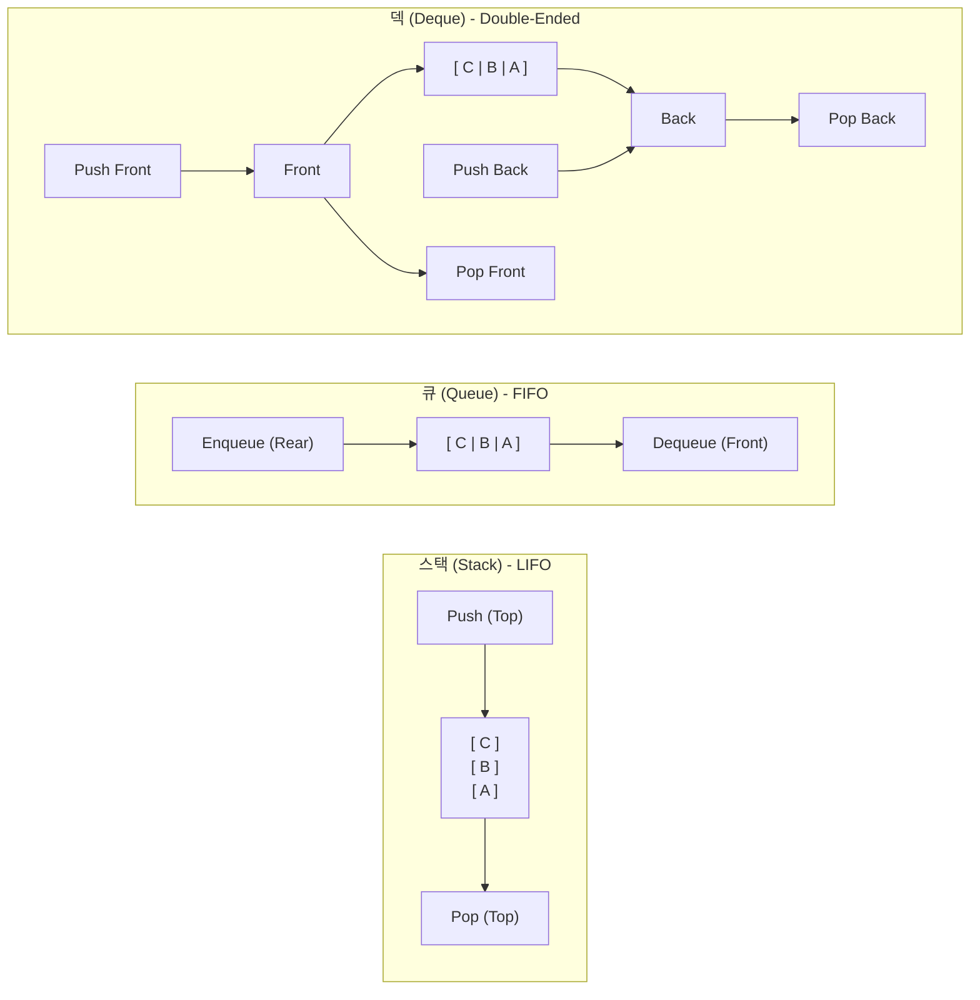

# 스택(Stack), 큐(Queue), 덱(Deque)의 이해와 Mini Redis에서의 활용

이 문서는 자료구조의 핵심 선형 추상 자료형(ADT)인 **스택(Stack)**, **큐(Queue)**, **덱(Deque)**의 구조적 차이와 시간 복잡도, 그리고 Redis 및 Mini Redis 구현에서 이들이 어떻게 활용되는지 심층적으로 정리합니다.

---

## 1. 선형 자료구조 3대 개념 비교

### 1.1 스택 (Stack)
- **원리**: **LIFO (Last-In, First-Out, 후입선출)**. 가장 마지막에 들어온 데이터가 가장 먼저 나가는 구조.
- **주요 연산**:
  - `push(item)`: 맨 위(Top)에 요소 추가
  - `pop()`: 맨 위(Top) 요소 제거 및 반환
  - `peek()`: 맨 위(Top) 요소 조회 (제거하지 않음)
  - `is_empty()`: 비어있는지 확인

### 1.2 큐 (Queue)
- **원리**: **FIFO (First-In, First-Out, 선입선출)**. 가장 먼저 들어온 데이터가 가장 먼저 나가는 구조 (예: 대기줄, 프린터 스풀러).
- **주요 연산**:
  - `enqueue(item)`: 맨 뒤(Rear/Back)에 요소 추가
  - `dequeue()`: 맨 앞(Front) 요소 제거 및 반환
  - `peek()`: 맨 앞(Front) 요소 조회

### 1.3 덱 (Deque - Double-Ended Queue)
- **원리**: 양쪽 끝(Front, Rear) 모두에서 삽입과 삭제가 자유롭게 일어나는 양방향 선형 자료구조.
- 스택의 성질(한쪽 끝 삽입/삭제)과 큐의 성질(한쪽 끝 삽입, 다른쪽 끝 삭제)을 모두 포함하는 상위 호환 추상 자료형입니다.
- **주요 연산**:
  - `push_front()`, `push_back()`
  - `pop_front()`, `pop_back()`
  - `peek_front()`, `peek_back()`

---

## 2. 연산별 시간 복잡도 비교

| 자료구조 | 앞단 삽입 (Front Insert) | 앞단 삭제 (Front Delete) | 뒷단 삽입 (Back Insert) | 뒷단 삭제 (Back Delete) | 임의 접근 (Index Lookup) |
|---|:---:|:---:|:---:|:---:|:---:|
| **연속 메모리 배열 (동적 배열)** | $O(n)$ | $O(n)$ | Amortized $O(1)$ | $O(1)$ | $O(1)$ |
| **단일 연결 리스트 (Singly Linked)** | $O(1)$ | $O(1)$ | $O(1)$ (tail 참조 시) | $O(n)$ (tail 직전 탐색) | $O(n)$ |
| **이중 연결 리스트 (Doubly Linked)** | **$O(1)$** | **$O(1)$** | **$O(1)$** | **$O(1)$** | $O(n)$ |

> **핵심 인사이트**: 
> 일반 동적 배열(`list`)을 사용해 큐를 구현하면 `pop(0)` 연산 시 뒷부분의 모든 원소를 한 칸씩 앞으로 당겨야 하므로 $O(n)$의 성능 저하가 발생합니다. 반면 **이중 연결 리스트(DoublyLinkedList)**를 사용하면 노드의 포인터 2개(`prev`, `next`)만 재연결하므로 앞단/뒷단 삽입/삭제가 모두 **순수 $O(1)$**로 보장되어 완벽한 덱(Deque)을 이룹니다.

---

## 3. Mini Redis에서의 구현 및 활용

본 프로젝트에서는 직접 구현한 `DoublyLinkedList`를 기반으로 덱/큐의 메커니즘을 여러 핵심 기능에 적극 활용하고 있습니다.

### 3.1 LRU(Least Recently Used) 캐시 순서 추적에서의 덱 활용
- **동작 방식**:
  - 신규 키가 들어오거나(`SET`), 기존 키를 조회할 때(`GET`), 해당 노드를 리스트 맨 앞(`insert_front` / `move_to_front`)으로 이동시킵니다.
  - 메모리가 한도(`maxmemory`)를 초과하면, 가장 오래 참조되지 않은 맨 뒤 노드를 `remove_back()`으로 $O(1)$에 방출(Eviction)합니다.
- **자료구조 매핑**:
  - Front = 가장 최근에 사용된 키 (MRU, Most Recently Used)
  - Back = 가장 오래전에 사용된 키 (LRU, Least Recently Used)
  - 덱의 양방향 삽입/삭제 특성을 정확히 활용하여 $O(1)$ LRU 캐시 교체 정책을 완성합니다.

### 3.2 Pub/Sub (발행/구독) 메시지 큐로서의 활용
- **동작 방식**:
  - 각 구독자(`Subscriber`)는 자신만의 메시지 수신함(`inbox`)을 `DoublyLinkedList`로 보유합니다.
  - 채널에 메시지가 발행(`PUBLISH`)되면 브로커가 구독자 수신함의 뒤쪽(`insert_back`)에 메시지를 큐잉합니다 (Enqueue).
  - 구독자가 메시지를 읽어갈 때는 앞쪽(`remove_front`)에서부터 차례로 꺼내 처리합니다 (Dequeue).
- **보장성**:
  - 발행된 순서 그대로 메시지가 전달되는 **FIFO 순서 엄격 보장**.

### 3.3 트리 너비 우선 탐색 (BFS / Level-Order Traversal)
- `BinaryTree`의 `level_order()` 및 `insert_level_order()` 메서드에서 자체 구현한 `DoublyLinkedList`를 FIFO 큐로 사용하여 노드를 레벨 단위로 순회합니다.

---

## 4. 실제 Redis 아키텍처와의 연계

1. **Redis List 타입 (`quicklist`)**:
   - Redis의 `LPUSH`, `RPUSH`, `LPOP`, `RPOP` 명령어는 리스트를 스택으로도, 큐로도 사용할 수 있는 완전한 **덱(Deque)** 인터페이스를 제공합니다.
   - 실제 Redis 내부에서는 압축 효율과 O(1) 포인터 이동의 장점을 결합한 `quicklist` (이중 연결 리스트의 각 노드에 작은 고정 압축 배열인 `ziplist`를 담은 구조)를 사용합니다.
2. **Redis Streams & Message Broker**:
   - Redis의 메시징 시스템과 이벤트 큐 또한 소비자 그룹(Consumer Group)별 큐잉 및 승인(ACK) 대기 큐 구조로 선형 큐/덱 모델을 활용합니다.
